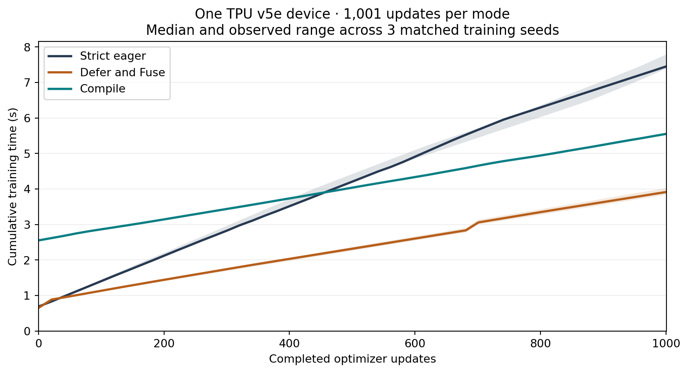
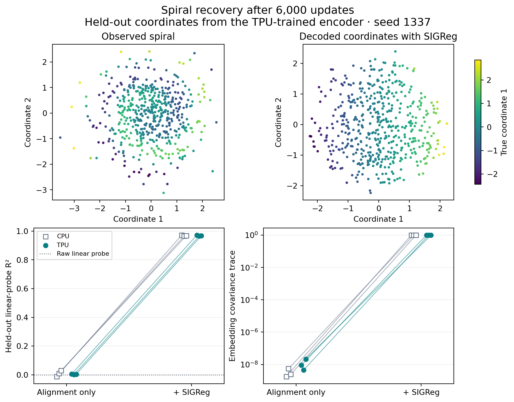

# When does compiling pay off on TorchTPU? A LeJEPA spiral experiment

[Read the step-by-step written tutorial](https://ab-naidu.github.io/torchtpu-lejepa-spiral/) · [Open the runnable notebook in Colab](https://colab.research.google.com/github/ab-naidu/torchtpu-lejepa-spiral/blob/main/LeJEPA_TorchTPU.ipynb)

For a PyTorch training loop on a Cloud TPU, how many steps does it take for Defer and Fuse or `torch.compile` to pay back its startup cost against strict eager? This tutorial measures that crossover and checks that the model still learns the same task. Each comparison uses a single TPU device and fresh processes with matched initial weights and inputs.

In this experiment the encoder sees two noisy views of a hidden point. Each view has been rotated through an angle that depends on its distance from the origin. The observed cloud still looks Gaussian. Can the encoder learn a representation from which a straight-line readout recovers the original coordinates?

Open the standalone notebook for a guided run. The default CPU path works without an accelerator. On a compatible TPU runtime, enable the notebook’s TPU switch to run the native backend. [Open in Colab](https://colab.research.google.com/github/ab-naidu/torchtpu-lejepa-spiral/blob/main/LeJEPA_TorchTPU.ipynb) · [Notebook source](LeJEPA_TorchTPU.ipynb) · [Cloud TPU VM setup](CLOUD.md)

## What happened on a Cloud TPU v5e

**Defer and Fuse finished 1,001 updates fastest.** Compilation delivered the highest warm throughput, but took longer to start. Across three seeds, compiled execution overtook strict eager between steps 401 and 461. Defer and Fuse held a cumulative lead over eager from step 41 onward in every trial.

| Execution mode | First step | Warm throughput | Time for 1,001 updates |
| --- | ---: | ---: | ---: |
| Strict eager | 0.69 s | 148.5 steps/s | 7.46 s |
| Defer and Fuse | 0.66 s | 323.4 steps/s | **3.92 s** |
| `torch.compile` | 2.55 s | **337.2 steps/s** | 5.55 s |

These are medians across three seeds on one v5e chip using TorchTPU 0.3.0 and PyTorch 2.15.0. The cumulative curves include startup. Crossovers are bracketed by timing measurements taken every 20 updates. The same allocation ran each mode in a fresh process, in the order eager, fused, compiled. The results apply to this fixed-shape float32 workload. [Per-seed comparisons, measurement scope and raw records](results/summary/summary.md)



The model also learned the task on TPU. After 6,000 updates, mean held-out recovery R² was **0.969 ± 0.004** with SIGReg and **0.003 ± 0.002** with alignment alone. The latter’s mean embedding variance fell to 1.17 × 10⁻⁸. All 25 TPU invocations passed the first-step loss and gradient checks against CPU. The six full-length ablations used strict eager. [TPU run records and figures](results/tpu-report/report.md)



## Why compare these three TorchTPU modes?

Basile and colleagues describe a native PyTorch backend that can execute individual operations, defer and fuse small groups of operations, or compile a larger captured graph. Fusing compatible operations can reduce dispatch overhead. Preparing an executable also takes time. Our small MLP and the sine, cosine and reduction operations in SIGReg give these trade-offs a concrete test. We use fixed shapes, keep scalar reads outside the timed loop, and synchronize the device at measurement boundaries because TPU work is dispatched asynchronously. [TorchTPU architecture paper, v5](https://arxiv.org/abs/2610.24161v5) · [TorchTPU execution model](https://torchtpu.readthedocs.io/en/latest/torchtpu_execution_model/)

The TorchTPU maintainers report a mean step time of 178.61 ms in eager and 159.33 ms with compilation alone for a FLUX transformer block on one v6e chip. Their block uses bfloat16 and a 32,768-token sequence. Here the workload is a small float32 encoder. We measure both first-use cost and repeated steps to find the answer for that workload. [Official FLUX benchmark and measurement setup](https://torchtpu.readthedocs.io/en/latest/case_studies_flux/)

## What happened on CPU

Across three matched training seeds, the regularized encoder recovered the hidden coordinates with a mean held-out R² of **0.969**. The same network trained on alignment alone scored **0.009** and produced nearly constant outputs. The linear readout applied directly to the observations scored **0.00023**.

| Training objective | Held-out R², mean ± sample SD | Mean total embedding variance |
| --- | ---: | ---: |
| Alignment + SIGReg | 0.969 ± 0.004 | 1.004 |
| Alignment only | 0.009 ± 0.020 | 3.24 × 10⁻⁹ |

All six runs used 6,000 updates and passed the runner’s CPU loss and gradient checks. The three training seeds share an evaluation split. The spread measures sensitivity to training seed. Performance on TPU is a separate hardware measurement. [Raw runs and figures](results/cpu-report/report.md)

## Run a first experiment

Use an environment with PyTorch and Matplotlib. On a CPU machine, install them with `python -m pip install torch matplotlib`. On a TPU VM, use the matched PyTorch and TorchTPU environment in the cloud instructions. For CLI use, keep `spiral.py`, `run_experiment.py` and `report_results.py` together. In Colab, open the notebook and run all cells. It restores missing scripts from its embedded, checksum-verified copies. In a checkout, it runs the files already present.

```sh
python run_experiment.py --device cpu --mode eager --seed 1337 --steps 256 --output runs/first
python report_results.py --runs runs --out report
```

Open `report/report.md`. A short run exercises training, evaluation, and plotting. To reproduce the longer CPU experiment, run both commands below for each of seeds 1337, 1338 and 1339, using the seed in each output directory name. Each command requires a fresh output directory.

```sh
python run_experiment.py --device cpu --mode eager --seed 1337 --steps 6000 --width 128 --batch-size 128 --slices 64 --block-size 50 --weight 0.001 --output runs/1337-sigreg
python run_experiment.py --device cpu --mode eager --seed 1337 --steps 6000 --width 128 --batch-size 128 --slices 64 --block-size 50 --weight 0 --output runs/1337-alignment
```

## What the encoder learns

1. Draw a hidden 2-D point from a standard Gaussian. Draw two noisy views with independent noise around this center. Rotate each by π times its radius. A point near the origin turns a little while a distant point may wrap all the way around. Radius and the overall Gaussian distribution are preserved.
2. Give the observed pair to a four-layer MLP with a two-dimensional output. An alignment loss draws the two outputs together. A constant output solves alignment on its own. With weight 0.001, SIGReg also encourages the outputs to have standard Gaussian distributions along randomly sampled directions. The implementation evaluates the characteristic function with real-valued sine and cosine operations.
3. Freeze the encoder. Fit an affine readout from embeddings to known coordinates on 2,048 examples, then score it on a separate 2,048. The training objective never receives the true coordinates. Fit a second readout directly on the scrambled observations to measure what a linear baseline already knows.
4. Read held-out R² together with the two eigenvalues of the embedding covariance. A high R² indicates linearly recoverable coordinates on this test distribution. Tiny eigenvalues mean the outputs barely vary. The plots use the same held-out points and colors throughout, so a swirl disappearing after the readout has a quantitative check.

This is a compact adaptation of the synthetic two-dimensional task in *When Does LeJEPA Learn a World Model?* The smaller network and training schedule keep the experiment inexpensive. The result concerns this data generator and an affine readout. [Paper](https://arxiv.org/abs/2605.26379) · [Authors’ experiment](https://github.com/klindtlab/lejepa-identifiability/tree/main/experiments)

## Compare execution on one TPU

Use the same machine, seed, SIGReg weight, shapes, optimizer and step count for all three modes. Run each mode in a separate process. Strict eager sends operations individually, Defer and Fuse lets TorchTPU group them, and `torch.compile(backend="tpu")` compiles the forward objective. Each path still computes gradients and takes an AdamW step. A single worker and device suffice for this example. [TorchTPU execution model](https://torchtpu.readthedocs.io/en/latest/torchtpu_execution_model/) · [Google Cloud setup](https://docs.cloud.google.com/tpu/docs/pytorch-on-tpu)

The runner times the first synchronized training step separately. It then times synchronized blocks of training updates. The warm steps/s figure excludes the first subsequent block. Measured training time includes forward, backward, optimizer and Python dispatch. Data generation, device transfers, evaluation and the parity check are outside that timer. The first-step value includes first execution and startup overhead. The raw JSON records the software versions, cache settings, source digest, timings and per-parameter gradient checks.

Compare the cumulative time curves across equal step counts. A faster warm step only pays off if the run lasts long enough to recover its higher startup cost. The report uses observed block boundaries and can show that no crossover was seen. A failed loss or gradient check disqualifies a run from the timing comparison. The CPU ablation uses a cheaper objective when its weight is zero and addresses a different question from the three-mode throughput test.

## Rebuild the published figures

The CPU and TPU measurements are JSON files in `results/cpu` and `results/tpu`. Each record includes its training configuration, hardware and software metadata, parity results, interval timings and coordinates for the recovery plot. Rebuild the two main figures and their evidence tables with this command.

```sh
python summarize_sprint.py --results results --out results/summary
```
