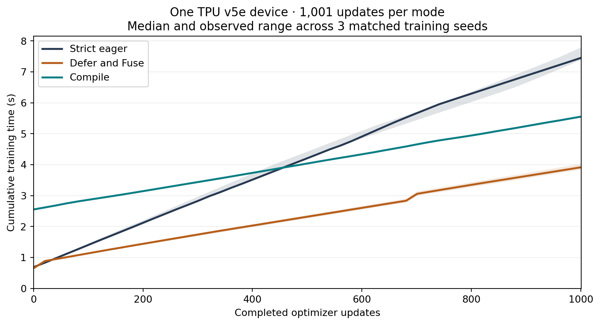
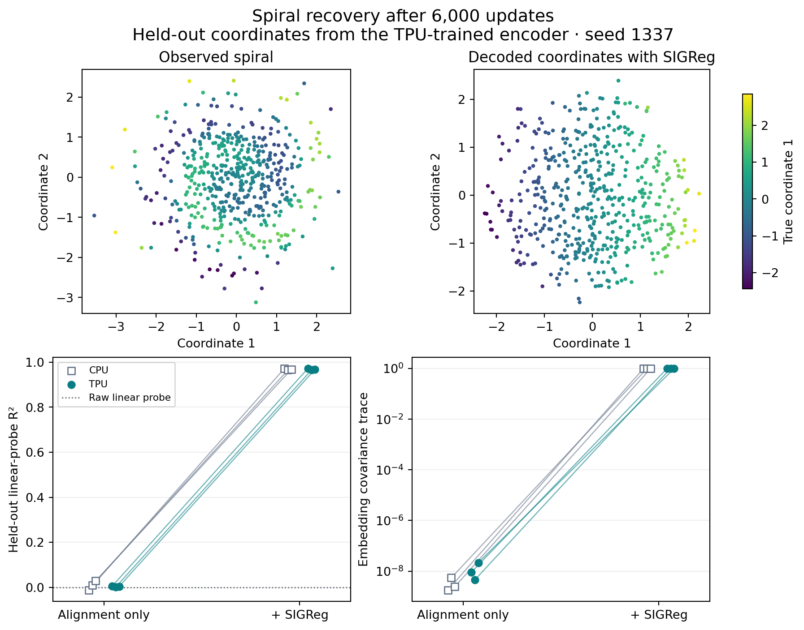

# When does compiling pay off on a Cloud TPU?

*Appalanaidu Bobbili · November 18, 2026 · TorchTPU Content Sprint*

If your training job lasts a thousand updates, would you turn on `torch.compile`? On one Cloud TPU v5e, compilation gave our small PyTorch encoder the highest throughput once warm. Yet **Defer and Fuse finished 1,001 updates first**, in 3.92 seconds. To see how both results can be true, you can run the same training loop three ways, keep the clock running through the first update, and compare the curves at the step where you would actually stop.

[Open the runnable notebook in Colab](https://colab.research.google.com/github/ab-naidu/torchtpu-lejepa-spiral/blob/main/LeJEPA_TorchTPU.ipynb) · [Get the sample code](https://github.com/ab-naidu/torchtpu-lejepa-spiral) · [Inspect the measurements](https://github.com/ab-naidu/torchtpu-lejepa-spiral/blob/main/results/summary/summary.md)

## Start with a spiral you can check

Imagine turning every point on a sheet of graph paper by an angle proportional to its distance from the origin. Nearby points turn a little. Distant points can wind all the way around. Start with a circular Gaussian cloud and the scrambled cloud still looks Gaussian. Color each point by its original horizontal coordinate, though, and you can see the twist.

We give an encoder two scrambled, noisy views of each hidden point. An alignment loss rewards it for giving the pair similar outputs. Mapping every point to the same place earns a perfect alignment score. A second term, SIGReg, encourages the batch of outputs to look Gaussian along randomly sampled directions. You’ll train with and without that term and check which encoder keeps enough information to recover the coordinates. The setup adapts a synthetic experiment from the LeJEPA literature. [Research paper](https://arxiv.org/abs/2605.26379) · [Authors’ implementation](https://github.com/klindtlab/lejepa-identifiability)

## Run your first comparison in Colab

1. Open the notebook above. For a quick CPU run, keep the defaults and choose **Runtime → Run all**. The notebook generates its own data and runs both training objectives. The default 256 updates let you check that training and plotting work.
2. For the hardware comparison, select an available, compatible TPU under **Runtime → Change runtime type**. In the configuration cell, set `RUN_TPU = True` and set `TPU_LABEL` to the accelerator you selected, for example `"v5e-1"` for a single v5e. Run all cells again. The setup reports the hardware it detects.
3. Open the generated report. Find the loss and gradient comparison against CPU, then the cumulative-time plot. To save your run, uncomment the two download lines in the final cell and execute that cell.

To check a native TorchTPU installation yourself, run this in a Python cell on the TPU worker. A successful check prints the device name and the four values computed on it. [Official TorchTPU setup](https://docs.cloud.google.com/tpu/docs/pytorch-on-tpu)

```python
import torch
import torch_tpu

x = torch.arange(4, device="tpu")
print(torch.tpu.get_device_properties().name, x.cpu().tolist())
```

## Time the step you actually train

**Strict eager** dispatches individual operations. **Defer and Fuse** lets TorchTPU group compatible operations. The **compiled** run wraps the forward objective with `torch.compile(objective, backend="tpu", fullgraph=True, dynamic=False)`. All three also run backward and take an AdamW step. The runner synchronizes the TPU before starting and after finishing each timing block. This measures completed work, including Python dispatch. Input generation, transfers, model setup, and evaluation are outside the timer. [Training loop](https://github.com/ab-naidu/torchtpu-lejepa-spiral/blob/main/run_experiment.py) · [TorchTPU execution model](https://torchtpu.readthedocs.io/en/latest/torchtpu_execution_model/) · [TorchTPU architecture paper](https://arxiv.org/abs/2610.24161v5)

To reproduce the published runs, clone the repository in Cloud Shell and follow the VM setup guide to select your allocation, export the project, zone, VM and API settings, and install TorchTPU on the worker. Then run the following **from the checkout in Cloud Shell**. The smoke test takes two updates. Each longer comparison starts a fresh process per mode and saves the individual JSON records under `cloud-runs/`. [Cloud TPU setup, results collection, and cleanup](https://github.com/ab-naidu/torchtpu-lejepa-spiral/blob/main/CLOUD.md)

```bash
bash run_cloud_suite.sh smoke 1337
for seed in 1337 1338 1339; do
  bash run_cloud_suite.sh long-benchmark "$seed" || break
done
```

The timing preset fixes batch size and encoder width at 128, uses 64 random projections, and runs 1,001 float32 updates. Each seed uses the same initialization and batches across modes. We ran the modes in a fixed order on one v5e chip with PyTorch 2.15.0 and TorchTPU 0.3.0. Here are the medians across the three seeds.

| Execution mode | First update | Warm updates/s | Total for 1,001 |
| --- | ---: | ---: | ---: |
| Strict eager | 0.69 s | 148.5 | 7.46 s |
| Defer and Fuse | 0.66 s | 323.4 | **3.92 s** |
| Compiled objective | 2.55 s | **337.2** | 5.55 s |



*Each point follows a device synchronization. Lines show the median across seeds. Shading spans their observed range.*

Try reading a crossover yourself. For seed 1337, eager reached update 441 in **3.7978 s** and compiled in **3.8731 s**. At update 461, compiled had pulled ahead, **3.9305 s** to eager’s **3.9378 s**. That brackets the crossover within 20 updates. Defer and Fuse had already reached update 461 in **2.2553 s**. The throughput column drops the first update and the next 20, whereas the total includes both. Use the total-time curve at your target training length when choosing a mode. A different shape, precision or TPU needs its own measurement. [Per-seed records](https://github.com/ab-naidu/torchtpu-lejepa-spiral/tree/main/results/tpu/long-benchmark-1337-bKiXCUxI)

## Check what the encoder learned

For the recovery experiment, run `bash run_cloud_suite.sh science 1337` from the same checkout. Repeat with seeds 1338 and 1339 for the published comparison. This preset trains paired strict-eager models for 6,000 updates with SIGReg weights of 0.001 and zero. After training, freeze the encoder and fit a linear readout with an intercept on 2,048 examples. Score it on 2,048 held-out examples. This is the first time the hidden coordinates enter the fitting procedure.



*Color follows the original horizontal coordinate. Look for its left-to-right ordering after the readout, then check the held-out score.*

A linear readout of the scrambled input scored **R² = 0.00023**. With SIGReg, mean held-out R² reached **0.969**. With alignment alone it was **0.003**, and total embedding variance fell to approximately **1.17 × 10⁻⁸**. The alignment-only encoder had learned to give nearly every point the same answer. All three training seeds shared the evaluation split. The recovery result concerns this synthetic distribution and this readout. [Recovery scores and raw runs](https://github.com/ab-naidu/torchtpu-lejepa-spiral/blob/main/results/summary/summary.md)

For your own training loop, plot cumulative time through the update you care about, then check a held-out measure of what the model learned. In this experiment, Defer and Fuse saved time over the 1,001-step run. Keeping SIGReg preserved the coordinates we wanted the encoder to learn.
