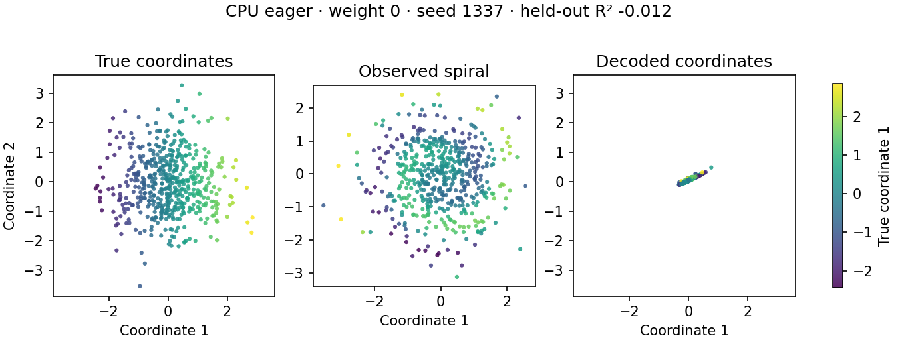
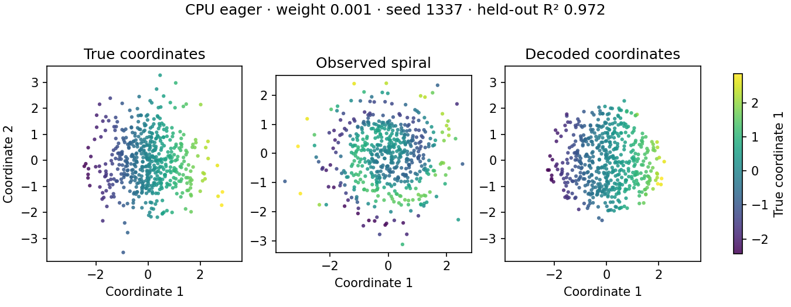
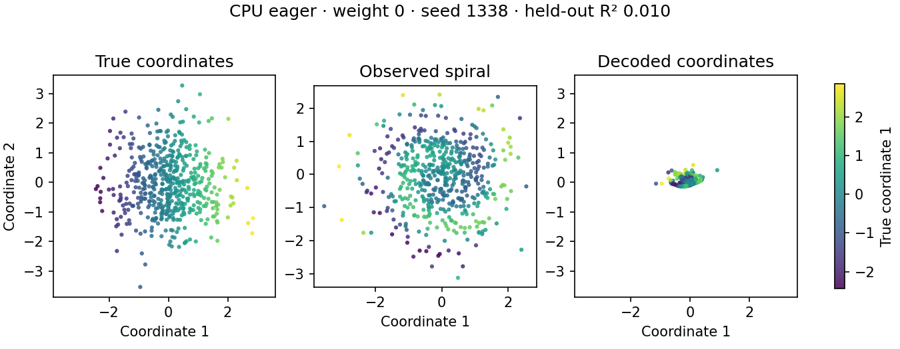
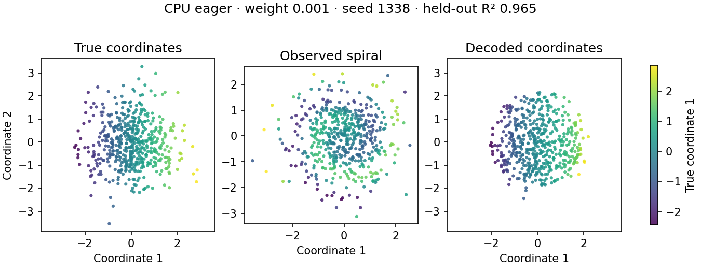
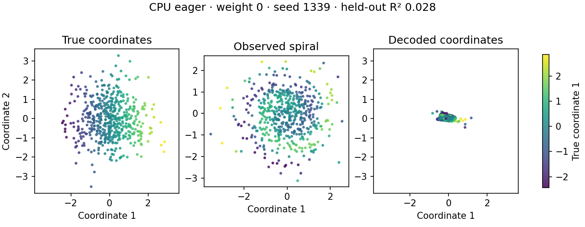
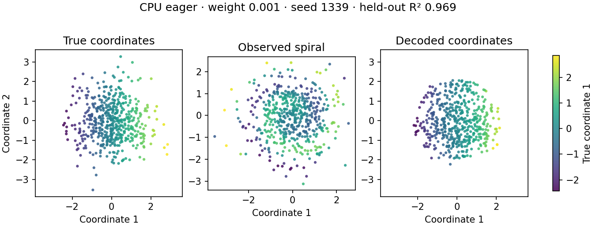

# LeJEPA measurements

Each row is one invocation. The first step includes initialization triggered by that step. The steady rate excludes step one and the first post-startup block. Covariance eigenvalues show the variance along both learned dimensions.

| Run | Device / mode | Seed | SIGReg weight | Status | Raw input R² | Learned R² | Covariance eigenvalues | First step (s) | Steady steps/s |
|---|---|---:|---:|---|---:|---:|---|---:|---:|
| [spiral-1337-alignment](../cpu/spiral-1337-alignment/result.json) | cpu / eager | 1337 | 0.0 | ok | 0.000 | -0.012 | 3.61e-10, 1.43e-09 | 0.004 | 601.0 |
| [spiral-1337-sigreg](../cpu/spiral-1337-sigreg/result.json) | cpu / eager | 1337 | 0.001 | ok | 0.000 | 0.972 | 0.487, 0.522 | 0.033 | 121.8 |
| [spiral-1338-alignment](../cpu/spiral-1338-alignment/result.json) | cpu / eager | 1338 | 0.0 | ok | 0.000 | 0.010 | 5.76e-10, 4.89e-09 | 0.005 | 552.9 |
| [spiral-1338-sigreg](../cpu/spiral-1338-sigreg/result.json) | cpu / eager | 1338 | 0.001 | ok | 0.000 | 0.965 | 0.464, 0.541 | 0.010 | 218.1 |
| [spiral-1339-alignment](../cpu/spiral-1339-alignment/result.json) | cpu / eager | 1339 | 0.0 | ok | 0.000 | 0.028 | 4.79e-10, 1.97e-09 | 0.004 | 614.9 |
| [spiral-1339-sigreg](../cpu/spiral-1339-sigreg/result.json) | cpu / eager | 1339 | 0.001 | ok | 0.000 | 0.969 | 0.487, 0.509 | 0.009 | 231.7 |

## Held-out coordinates

Color follows the same held-out sample across panels. A linear probe fitted on a separate split maps learned coordinates into the true coordinate system. The table also reports the raw-input linear probe. Compare variance with recovery to diagnose collapse.

**spiral-1337-alignment**

**spiral-1337-sigreg**

**spiral-1338-alignment**

**spiral-1338-sigreg**

**spiral-1339-alignment**

**spiral-1339-sigreg**

## Measured TPU break-even

No matched, parity-passing TPU eager/comparison pair is available.
