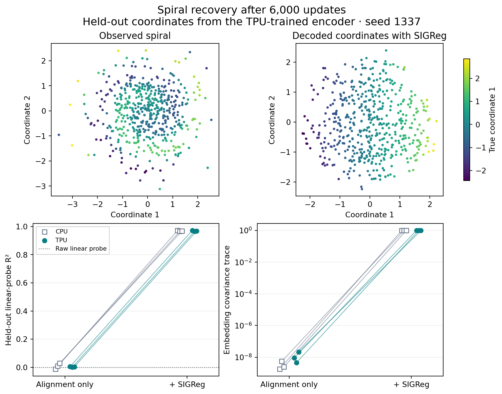
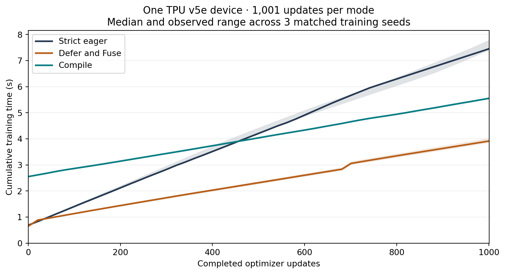

# Spiral recovery and the cost of compiling on TorchTPU

Two experiments separate what the encoder learns from how fast the training loop runs. Each included run passed a one-step comparison of its loss and all parameter gradients with CPU.

## Does the encoder recover the hidden coordinates?

Adding SIGReg changed mean TPU recovery from **R² 0.003** to **0.969** after 6,000 updates on the same training seeds.

Point color identifies the original first coordinate. The bottom panels connect the two objectives within each training seed.

| Device | Training seeds | Objective | Held-out R² | Embedding covariance trace |
| --- | --- | --- | ---: | ---: |
| TPU | 1337, 1338, 1339 | Alignment only | 0.003 ± 0.002 | 1.172e-08 ± 8.926e-09 |
| TPU | 1337, 1338, 1339 | Alignment + SIGReg | 0.969 ± 0.004 | 1.003 ± 0.005258 |
| CPU | 1337, 1338, 1339 | Alignment only | 0.009 ± 0.020 | 3.238e-09 ± 1.961e-09 |
| CPU | 1337, 1338, 1339 | Alignment + SIGReg | 0.969 ± 0.004 | 1.004 ± 0.006848 |

Values are means across training seeds with sample SD when multiple seeds are available. Each model trained for 6,000 updates. The affine probe uses 2,048 fit examples and 2,048 held-out examples shared across seeds (evaluation seed 1729). The raw-input linear probe scored 0.00023. The covariance trace sums variance along both learned dimensions. Values near zero indicate nearly constant outputs.

| TPU seed | R², alignment | R², + SIGReg | Trace, alignment | Trace, + SIGReg |
| ---: | ---: | ---: | ---: | ---: |
| 1337 | 0.005 | 0.972 | 8.947e-09 | 1.004 |
| 1338 | 0.001 | 0.965 | 4.515e-09 | 1.008 |
| 1339 | 0.004 | 0.968 | 2.171e-08 | 0.9972 |

TPU ablation records — 1337 ([λ=0.0](../tpu/science-1337-j9E5ybNb/eager-w0/result.json), [λ=0.001](../tpu/science-1337-j9E5ybNb/eager-w0.001/result.json)) · 1338 ([λ=0.0](../tpu/science-1338-6cwABfzQ/eager-w0/result.json), [λ=0.001](../tpu/science-1338-6cwABfzQ/eager-w0.001/result.json)) · 1339 ([λ=0.0](../tpu/science-1339-ESyjS1bq/eager-w0/result.json), [λ=0.001](../tpu/science-1339-ESyjS1bq/eager-w0.001/result.json))

CPU ablation records — 1337 ([λ=0.0](../cpu/spiral-1337-alignment/result.json), [λ=0.001](../cpu/spiral-1337-sigreg/result.json)) · 1338 ([λ=0.0](../cpu/spiral-1338-alignment/result.json), [λ=0.001](../cpu/spiral-1338-sigreg/result.json)) · 1339 ([λ=0.0](../cpu/spiral-1339-alignment/result.json), [λ=0.001](../cpu/spiral-1339-sigreg/result.json))

## When does compilation pay back its first-use cost?

This comparison covers 1,001 updates per mode at training seeds 1337, 1338, 1339, with 20-step timing blocks after the first update. The runtime reported 1 visible TPU v5e device. The fixed-shape float32 encoder uses width 128, batch size 128 and 64 projections. Python 3.12.16, PyTorch 2.15.0, TorchTPU 0.3.0, libtpu 0.0.53.1.

At update 1,001, **Defer and Fuse** had the lowest median cumulative time (3.92 s). Strict eager took 7.46 s and compilation took 5.55 s.

Lines show the pointwise median and shading spans the 3 observed seeds.

| Execution mode | First update (s) | Warm updates/s | Final cumulative time (s) |
| --- | ---: | ---: | ---: |
| Strict eager | 0.69 | 148.5 | 7.46 |
| Defer and Fuse | 0.66 | 323.4 | 3.92 |
| Compile | 2.55 | 337.2 | 5.55 |

Table entries are medians across the included seeds. Warm throughput excludes the first update and first subsequent block.

| Seed | Defer and Fuse vs eager | Compile vs eager |
| ---: | --- | --- |
| 1337 | Behind at step 21, at or ahead by step 41. Still at or ahead at the sampled boundaries through step 1001. | Behind at step 441, at or ahead by step 461. Still at or ahead at the sampled boundaries through step 1001. |
| 1338 | Behind at step 21, at or ahead by step 41. Still at or ahead at the sampled boundaries through step 1001. | Behind at step 401, at or ahead by step 421. Still at or ahead at the sampled boundaries through step 1001. |
| 1339 | Behind at step 21, at or ahead by step 41. Still at or ahead at the sampled boundaries through step 1001. | Behind at step 441, at or ahead by step 461. Still at or ahead at the sampled boundaries through step 1001. |

Crossovers are bounded by synchronized observations. Forward, backward, AdamW and dispatch are timed. Input preparation, copies, evaluation and parity checks are outside the timer. Compilation captures the forward objective. The first update includes execution and startup.

Timing records — 1337 ([Compile](../tpu/long-benchmark-1337-bKiXCUxI/compile-w0.001/result.json), [Strict eager](../tpu/long-benchmark-1337-bKiXCUxI/eager-w0.001/result.json), [Defer and Fuse](../tpu/long-benchmark-1337-bKiXCUxI/fused-w0.001/result.json)) · 1338 ([Compile](../tpu/long-benchmark-1338-1QedaxrB/compile-w0.001/result.json), [Strict eager](../tpu/long-benchmark-1338-1QedaxrB/eager-w0.001/result.json), [Defer and Fuse](../tpu/long-benchmark-1338-1QedaxrB/fused-w0.001/result.json)) · 1339 ([Compile](../tpu/long-benchmark-1339-VELxXSsu/compile-w0.001/result.json), [Strict eager](../tpu/long-benchmark-1339-VELxXSsu/eager-w0.001/result.json), [Defer and Fuse](../tpu/long-benchmark-1339-VELxXSsu/fused-w0.001/result.json))
