# LeJEPA measurements

Each row is one invocation. The first step includes initialization triggered by that step. The steady rate excludes step one and the first post-startup block. Covariance eigenvalues show the variance along both learned dimensions.

| Run | Device / mode | Seed | SIGReg weight | Status | Raw input R² | Learned R² | Covariance eigenvalues | First step (s) | Steady steps/s |
|---|---|---:|---:|---|---:|---:|---|---:|---:|
| [benchmark-1337-UFcaWW52/compile-w0.001](../tpu/benchmark-1337-UFcaWW52/compile-w0.001/result.json) | tpu / compile | 1337 | 0.001 | ok | 0.000 | 0.056 | 0.00278, 0.549 | 2.538 | 356.9 |
| [benchmark-1337-UFcaWW52/eager-w0.001](../tpu/benchmark-1337-UFcaWW52/eager-w0.001/result.json) | tpu / eager | 1337 | 0.001 | ok | 0.000 | 0.056 | 0.00279, 0.549 | 0.703 | 136.2 |
| [benchmark-1337-UFcaWW52/fused-w0.001](../tpu/benchmark-1337-UFcaWW52/fused-w0.001/result.json) | tpu / fused | 1337 | 0.001 | ok | 0.000 | 0.057 | 0.00283, 0.548 | 0.661 | 301.5 |
| [benchmark-1338-neLVVnOJ/compile-w0.001](../tpu/benchmark-1338-neLVVnOJ/compile-w0.001/result.json) | tpu / compile | 1338 | 0.001 | ok | 0.000 | 0.141 | 0.0645, 0.526 | 2.568 | 387.9 |
| [benchmark-1338-neLVVnOJ/eager-w0.001](../tpu/benchmark-1338-neLVVnOJ/eager-w0.001/result.json) | tpu / eager | 1338 | 0.001 | ok | 0.000 | 0.139 | 0.0629, 0.527 | 0.697 | 144.0 |
| [benchmark-1338-neLVVnOJ/fused-w0.001](../tpu/benchmark-1338-neLVVnOJ/fused-w0.001/result.json) | tpu / fused | 1338 | 0.001 | ok | 0.000 | 0.141 | 0.0645, 0.527 | 0.661 | 333.6 |
| [benchmark-1339-GX5AaDwB/compile-w0.001](../tpu/benchmark-1339-GX5AaDwB/compile-w0.001/result.json) | tpu / compile | 1339 | 0.001 | ok | 0.000 | 0.378 | 0.278, 0.467 | 2.587 | 310.2 |
| [benchmark-1339-GX5AaDwB/eager-w0.001](../tpu/benchmark-1339-GX5AaDwB/eager-w0.001/result.json) | tpu / eager | 1339 | 0.001 | ok | 0.000 | 0.378 | 0.278, 0.467 | 0.718 | 126.7 |
| [benchmark-1339-GX5AaDwB/fused-w0.001](../tpu/benchmark-1339-GX5AaDwB/fused-w0.001/result.json) | tpu / fused | 1339 | 0.001 | ok | 0.000 | 0.378 | 0.278, 0.467 | 0.672 | 330.9 |
| [long-benchmark-1337-bKiXCUxI/compile-w0.001](../tpu/long-benchmark-1337-bKiXCUxI/compile-w0.001/result.json) | tpu / compile | 1337 | 0.001 | ok | 0.000 | 0.910 | 0.428, 0.522 | 2.595 | 338.3 |
| [long-benchmark-1337-bKiXCUxI/eager-w0.001](../tpu/long-benchmark-1337-bKiXCUxI/eager-w0.001/result.json) | tpu / eager | 1337 | 0.001 | ok | 0.000 | 0.907 | 0.42, 0.522 | 0.695 | 140.6 |
| [long-benchmark-1337-bKiXCUxI/fused-w0.001](../tpu/long-benchmark-1337-bKiXCUxI/fused-w0.001/result.json) | tpu / fused | 1337 | 0.001 | ok | 0.000 | 0.905 | 0.42, 0.526 | 0.659 | 312.1 |
| [long-benchmark-1338-1QedaxrB/compile-w0.001](../tpu/long-benchmark-1338-1QedaxrB/compile-w0.001/result.json) | tpu / compile | 1338 | 0.001 | ok | 0.000 | 0.945 | 0.445, 0.493 | 2.555 | 337.2 |
| [long-benchmark-1338-1QedaxrB/eager-w0.001](../tpu/long-benchmark-1338-1QedaxrB/eager-w0.001/result.json) | tpu / eager | 1338 | 0.001 | ok | 0.000 | 0.943 | 0.444, 0.497 | 0.694 | 148.5 |
| [long-benchmark-1338-1QedaxrB/fused-w0.001](../tpu/long-benchmark-1338-1QedaxrB/fused-w0.001/result.json) | tpu / fused | 1338 | 0.001 | ok | 0.000 | 0.944 | 0.448, 0.495 | 0.661 | 323.4 |
| [long-benchmark-1339-VELxXSsu/compile-w0.001](../tpu/long-benchmark-1339-VELxXSsu/compile-w0.001/result.json) | tpu / compile | 1339 | 0.001 | ok | 0.000 | 0.917 | 0.467, 0.57 | 2.554 | 329.7 |
| [long-benchmark-1339-VELxXSsu/eager-w0.001](../tpu/long-benchmark-1339-VELxXSsu/eager-w0.001/result.json) | tpu / eager | 1339 | 0.001 | ok | 0.000 | 0.917 | 0.468, 0.571 | 0.686 | 149.1 |
| [long-benchmark-1339-VELxXSsu/fused-w0.001](../tpu/long-benchmark-1339-VELxXSsu/fused-w0.001/result.json) | tpu / fused | 1339 | 0.001 | ok | 0.000 | 0.917 | 0.466, 0.572 | 0.661 | 330.3 |
| [science-1337-j9E5ybNb/eager-w0](../tpu/science-1337-j9E5ybNb/eager-w0/result.json) | tpu / eager | 1337 | 0.0 | ok | 0.000 | 0.005 | 3.47e-09, 5.47e-09 | 0.303 | 303.5 |
| [science-1337-j9E5ybNb/eager-w0.001](../tpu/science-1337-j9E5ybNb/eager-w0.001/result.json) | tpu / eager | 1337 | 0.001 | ok | 0.000 | 0.972 | 0.484, 0.52 | 0.694 | 156.5 |
| [science-1338-6cwABfzQ/eager-w0](../tpu/science-1338-6cwABfzQ/eager-w0/result.json) | tpu / eager | 1338 | 0.0 | ok | 0.000 | 0.001 | 1.16e-09, 3.36e-09 | 0.299 | 288.8 |
| [science-1338-6cwABfzQ/eager-w0.001](../tpu/science-1338-6cwABfzQ/eager-w0.001/result.json) | tpu / eager | 1338 | 0.001 | ok | 0.000 | 0.965 | 0.467, 0.54 | 0.694 | 148.0 |
| [science-1339-ESyjS1bq/eager-w0](../tpu/science-1339-ESyjS1bq/eager-w0/result.json) | tpu / eager | 1339 | 0.0 | ok | 0.000 | 0.004 | 3.22e-09, 1.85e-08 | 0.309 | 233.1 |
| [science-1339-ESyjS1bq/eager-w0.001](../tpu/science-1339-ESyjS1bq/eager-w0.001/result.json) | tpu / eager | 1339 | 0.001 | ok | 0.000 | 0.968 | 0.489, 0.508 | 0.687 | 148.0 |
| [smoke-1339-kR7Ws0Cy/eager-w0.001](../tpu/smoke-1339-kR7Ws0Cy/eager-w0.001/result.json) | tpu / eager | 1339 | 0.001 | ok | 0.000 | 0.005 | 0.00105, 0.00631 | 0.682 | — |

## Held-out coordinates

Color follows the same held-out sample across panels. A linear probe fitted on a separate split maps learned coordinates into the true coordinate system. The table also reports the raw-input linear probe. Compare variance with recovery to diagnose collapse.

**benchmark-1337-UFcaWW52/compile-w0.001**

**benchmark-1337-UFcaWW52/eager-w0.001**

**benchmark-1337-UFcaWW52/fused-w0.001**

**benchmark-1338-neLVVnOJ/compile-w0.001**

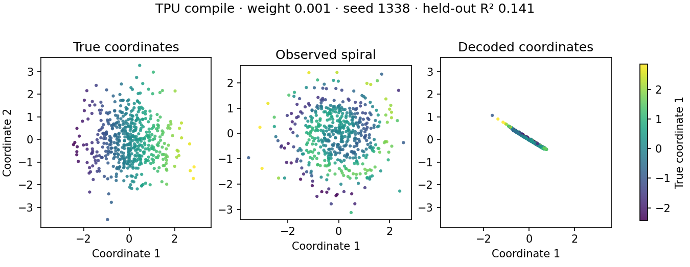

**benchmark-1338-neLVVnOJ/eager-w0.001**

**benchmark-1338-neLVVnOJ/fused-w0.001**

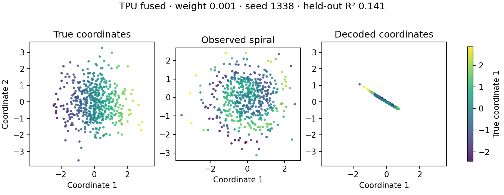

**benchmark-1339-GX5AaDwB/compile-w0.001**

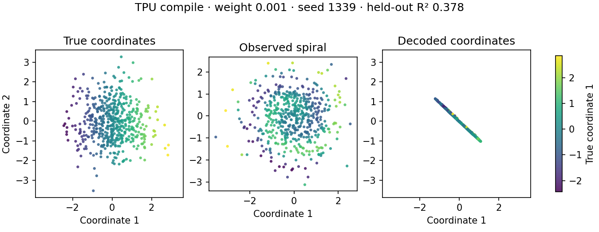

**benchmark-1339-GX5AaDwB/eager-w0.001**

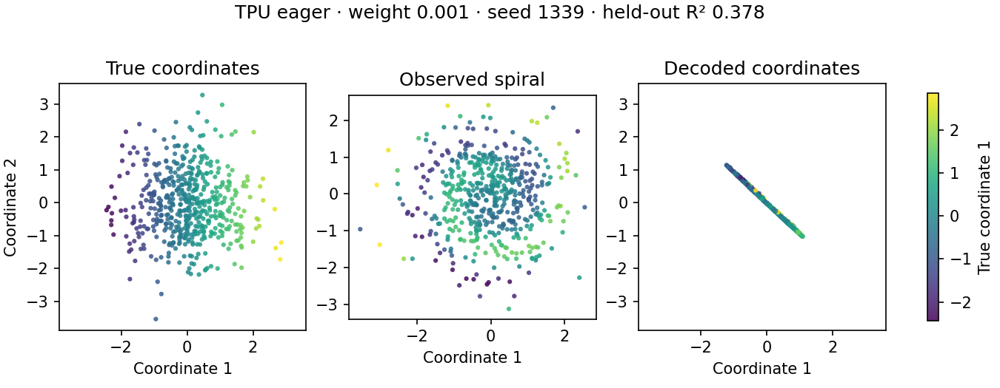

**benchmark-1339-GX5AaDwB/fused-w0.001**

**long-benchmark-1337-bKiXCUxI/compile-w0.001**

**long-benchmark-1337-bKiXCUxI/eager-w0.001**

**long-benchmark-1337-bKiXCUxI/fused-w0.001**

**long-benchmark-1338-1QedaxrB/compile-w0.001**

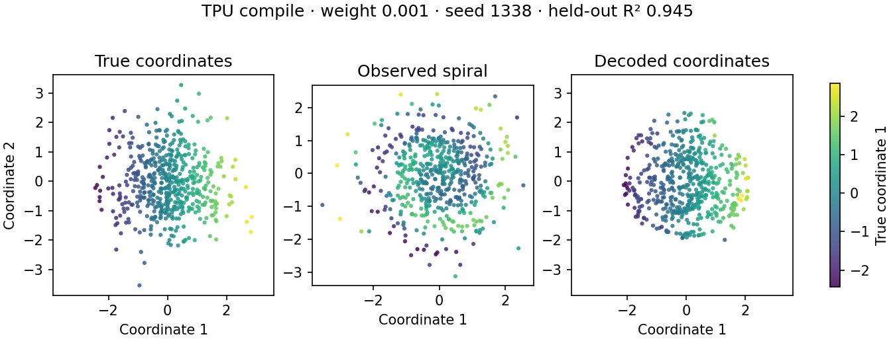

**long-benchmark-1338-1QedaxrB/eager-w0.001**

**long-benchmark-1338-1QedaxrB/fused-w0.001**

**long-benchmark-1339-VELxXSsu/compile-w0.001**

**long-benchmark-1339-VELxXSsu/eager-w0.001**

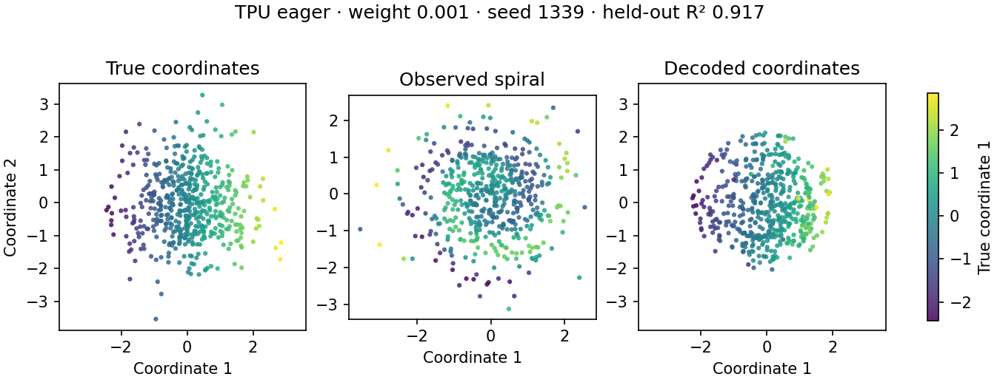

**long-benchmark-1339-VELxXSsu/fused-w0.001**

**science-1337-j9E5ybNb/eager-w0**

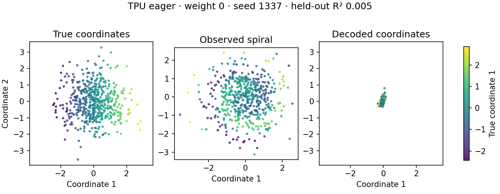

**science-1337-j9E5ybNb/eager-w0.001**

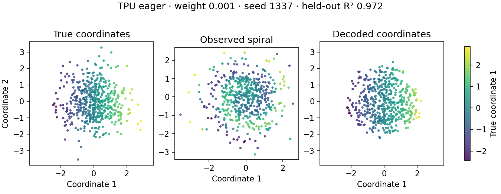

**science-1338-6cwABfzQ/eager-w0**

**science-1338-6cwABfzQ/eager-w0.001**

**science-1339-ESyjS1bq/eager-w0**

**science-1339-ESyjS1bq/eager-w0.001**

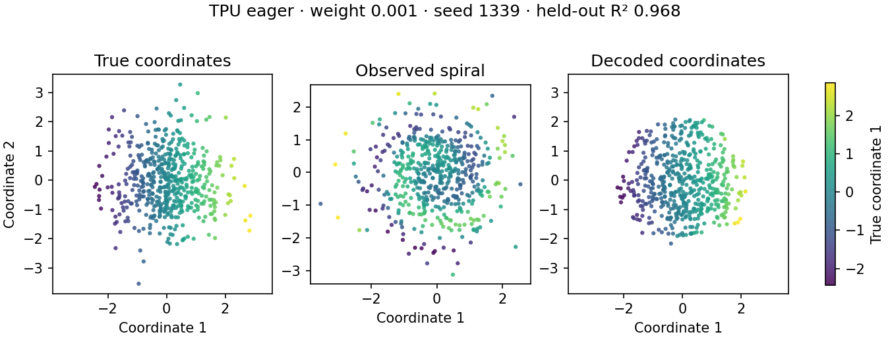

**smoke-1339-kR7Ws0Cy/eager-w0.001**

## Measured TPU break-even

Matched runs: benchmark-1337-UFcaWW52/compile-w0.001, benchmark-1337-UFcaWW52/eager-w0.001, benchmark-1337-UFcaWW52/fused-w0.001.

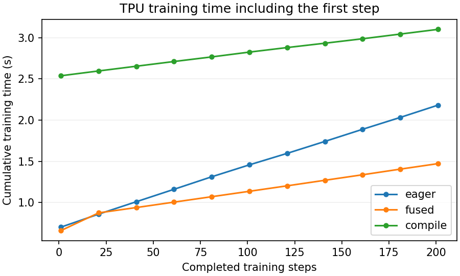

- **compile vs eager** — No observed break-even through step 201.
- **fused vs eager** — Behind at step 21, at or ahead by step 41. Still at or ahead at the sampled boundaries through step 201.

Matched runs: benchmark-1338-neLVVnOJ/compile-w0.001, benchmark-1338-neLVVnOJ/eager-w0.001, benchmark-1338-neLVVnOJ/fused-w0.001.

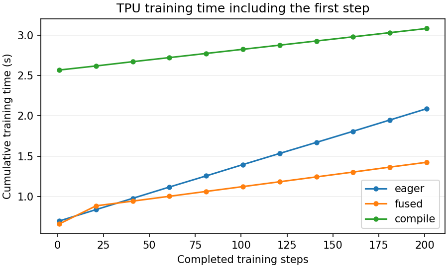

- **compile vs eager** — No observed break-even through step 201.
- **fused vs eager** — Behind at step 21, at or ahead by step 41. Still at or ahead at the sampled boundaries through step 201.

Matched runs: benchmark-1339-GX5AaDwB/compile-w0.001, benchmark-1339-GX5AaDwB/eager-w0.001, benchmark-1339-GX5AaDwB/fused-w0.001.

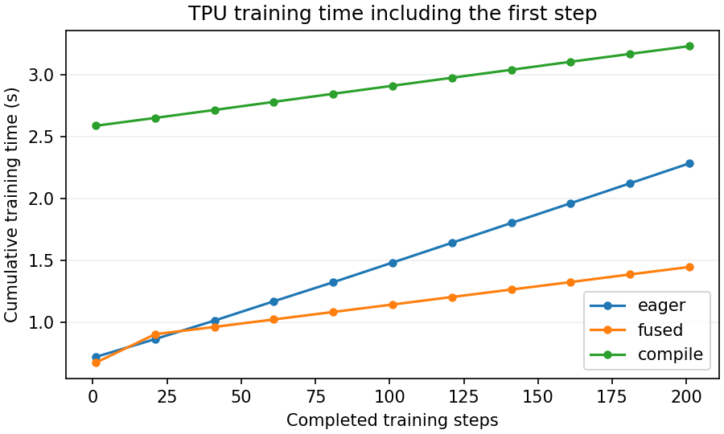

- **compile vs eager** — No observed break-even through step 201.
- **fused vs eager** — Behind at step 21, at or ahead by step 41. Still at or ahead at the sampled boundaries through step 201.

Matched runs: long-benchmark-1337-bKiXCUxI/compile-w0.001, long-benchmark-1337-bKiXCUxI/eager-w0.001, long-benchmark-1337-bKiXCUxI/fused-w0.001.

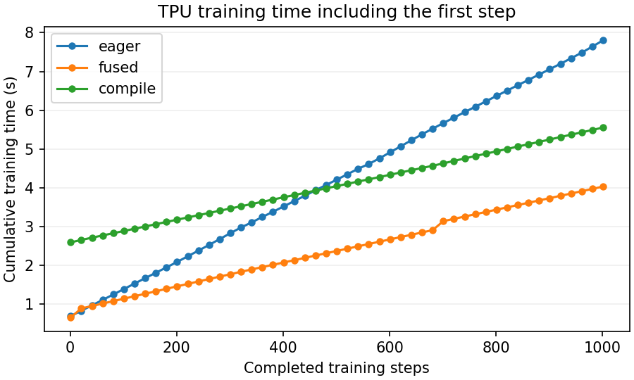

- **compile vs eager** — Behind at step 441, at or ahead by step 461. Still at or ahead at the sampled boundaries through step 1001.
- **fused vs eager** — Behind at step 21, at or ahead by step 41. Still at or ahead at the sampled boundaries through step 1001.

Matched runs: long-benchmark-1338-1QedaxrB/compile-w0.001, long-benchmark-1338-1QedaxrB/eager-w0.001, long-benchmark-1338-1QedaxrB/fused-w0.001.

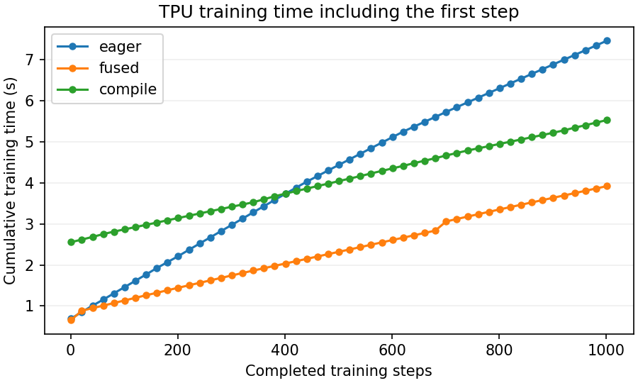

- **compile vs eager** — Behind at step 401, at or ahead by step 421. Still at or ahead at the sampled boundaries through step 1001.
- **fused vs eager** — Behind at step 21, at or ahead by step 41. Still at or ahead at the sampled boundaries through step 1001.

Matched runs: long-benchmark-1339-VELxXSsu/compile-w0.001, long-benchmark-1339-VELxXSsu/eager-w0.001, long-benchmark-1339-VELxXSsu/fused-w0.001.

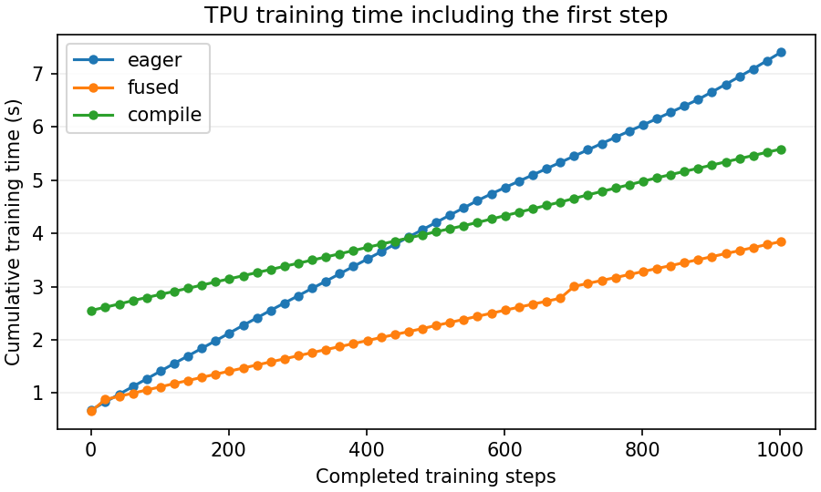

- **compile vs eager** — Behind at step 441, at or ahead by step 461. Still at or ahead at the sampled boundaries through step 1001.
- **fused vs eager** — Behind at step 21, at or ahead by step 41. Still at or ahead at the sampled boundaries through step 1001.

Each point is a synchronized timing boundary. Cumulative time includes the first call. Input staging outside timed blocks, process setup and evaluation are excluded. Lines connect sampled points; the exact crossover between observations is unknown.
